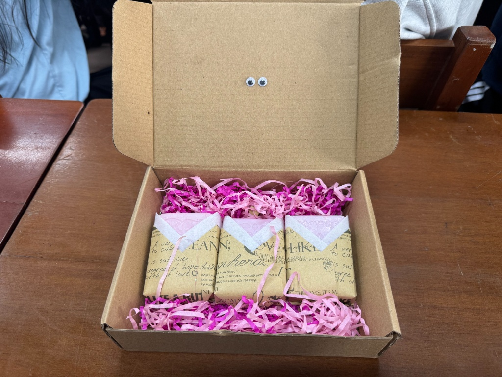

  

    
BÁO CÁO THỰC HÀNH HÓA HỌC

    <h1>ĐIỀU CHẾ XÀ PHÒNG HANDMADE</h1>
    
Từ dầu dừa đến sản phẩm làm sạch

    

    
TỔ: 1 · LỚP: 12A1

  

  

    
    
  

---

# Từ dầu dừa đến xà phòng

Một sản phẩm quen thuộc được tạo ra như thế nào từ phản ứng hóa học?

  

    <h2>Dầu dừa<strong> không là </strong>xà phòng.</h2>
    <h2><strong>Vậy </strong>điều gì<strong> đã </strong>biến đổi?</h2>
    
Trong buổi thực hành, nhóm đã sử dụng dầu dừa và môi trường kiềm để điều chế xà phòng, đồng thời quan sát sự thay đổi của hỗn hợp và sản phẩm thu được.

  

  

    
<strong>01</strong>Phản ứng hóa học

    
<strong>02</strong>Quan sát thực nghiệm

    
<strong>03</strong>Đánh giá sản phẩm

  

---

# Mục tiêu thực hành

Nhóm không chỉ tạo ra sản phẩm mà còn vận dụng kiến thức Hóa học để giải thích quá trình.

  

    
01 / HIỂU

    
⚗

    <h3>Hiểu nguyên lý</h3>
    
Giải thích phản ứng xà phòng hóa và vai trò của các nguyên liệu.

  

  

    
02 / QUAN SÁT

    
◉

    <h3>Theo dõi biến đổi</h3>
    
Nhận biết sự thay đổi trạng thái của hỗn hợp và đặc điểm sản phẩm.

  

  

    
03 / ĐÁNH GIÁ

    
✳

    <h3>Rút kinh nghiệm</h3>
    
Rèn luyện sự cẩn thận, chính xác, hợp tác và ý thức an toàn.

  

---

# Nguyên liệu & dụng cụ

Thành phần thực tế của nhóm và hình ảnh chuẩn bị trước buổi thực hành.

  

    

      
      

        NGUYÊN LIỆU CHÍNH
        <h2>Dầu dừa</h2>
        
Nguồn chất béo tham gia phản ứng xà phòng hóa.

      

    

    

      
<b>NaOH khan</b>Chất base phản ứng

      
<b>Nước cất</b>Pha dung dịch theo tài liệu thực hành

      
<b>Tinh dầu & màu</b>Tạo mùi hương và màu sắc

      
<b>Khuôn</b>Tạo hình bánh xà phòng

      
<b>Giấy pH & cân điện tử</b>Kiểm tra pH, cân nguyên liệu

      
<b>Găng tay, khẩu trang</b>Phương tiện bảo hộ thí nghiệm

    

  

  <PhotoFrame
    src="photos/01-nguyen-lieu-dung-cu.jpg"
    label="ẢNH 01"
    title="Nguyên liệu & dụng cụ"
    note="Thay bằng ảnh thực tế của nhóm"
    orientation="landscape"
    fit="cover"
  />

ĐỊNH LƯỢNG ĐƯỢC GIỮ THEO TÀI LIỆU THỰC HÀNH CỦA NHÓM.

---

# Cơ sở lý thuyết · Phản ứng xà phòng hóa

Xà phòng hóa là phản ứng thủy phân chất béo trong môi trường kiềm.

  
PHƯƠNG TRÌNH TỔNG QUÁT

  

    (RCOO)3C3H5
    +
    3NaOH
    →
    3RCOONa
    +
    C3H5(OH)3
  

  

    
<b>Muối natri của axit béo</b>Sản phẩm xà phòng

    
<b>Glycerol</b>Sản phẩm đồng tạo thành

  

  
<b>Chất béo</b>Thành phần phản ứng có trong dầu dừa.

  
<b>Môi trường kiềm</b>NaOH tham gia phản ứng thủy phân.

R ĐẠI DIỆN CHO GỐC HYDROCARBON CỦA AXIT BÉO.

---

# Vì sao xà phòng có thể làm sạch?

Muối natri của axit béo có hai phần với tính chất khác nhau.

  

    

      

      
COO⁻

    

    
ĐUÔI KỊ NƯỚCĐẦU ƯA NƯỚC

  

  

    
<b>Đầu ưa nước</b>
Tương tác thuận lợi với nước.

    
<b>Đuôi kị nước</b>
Có xu hướng liên kết với dầu mỡ.

    
<b>Tính lưỡng tính</b>
Giúp xà phòng hỗ trợ cuốn các chất bẩn dầu mỡ ra khỏi bề mặt khi rửa.

  

MỞ RỘNG: CÁC PHÂN TỬ XÀ PHÒNG TẬP HỢP THÀNH MICELLE, GIÚP PHÂN TÁN DẦU MỠ TRONG NƯỚC.

---

# Quy trình thực hành

Năm giai đoạn chính được ghi nhận trong buổi thực hành của nhóm.

  
01
⚖
<h3>Chuẩn bị</h3>
Nguyên liệu & dụng cụ

  
02
⚗
<h3>Pha dung dịch</h3>
Giai đoạn dung dịch kiềm

  
03
〰
<h3>Nhũ hóa</h3>
Theo dõi biến đổi hỗn hợp

  
04
✿
<h3>Hoàn thiện</h3>
Màu sắc, mùi hương

  
05
▱
<h3>Tạo hình</h3>
Đưa vào khuôn

  ✦
  
<b>Điểm quan sát quan trọng</b>
Hỗn hợp chuyển từ trong sang đục dần, sau đó xuất hiện độ sệt đặc trưng (trace).

---

# Một số lưu ý

Những điểm cần ghi nhớ trong quá trình thực hành.

  

01
<h3>Nhiệt độ</h3>
Tuân thủ giới hạn chênh lệch nhiệt độ được nêu trong tài liệu thực hành.

  

02
<h3>Trình tự pha</h3>
Không tự ý thay đổi hoặc đảo ngược trình tự được ghi trong tài liệu.

  

03
<h3>Găng tay</h3>
Đeo găng tay đầy đủ khi thực hiện với NaOH.

  

04
<h3>Công thức</h3>
Làm đúng công thức.

  

05
<h3>Kiên trì</h3>
Phải kiên trì, có kiên trì mới thành công

CHỈ SỬ DỤNG XÀ PHÒNG TRÊN DA KHI ĐÃ ĐƯỢC KIỂM TRA VÀ ĐẢM BẢO AN TOÀN.

---

# Hỗn hợp sau khi nhũ hóa

Ảnh thực tế ghi nhận trạng thái hỗn hợp sau giai đoạn nhũ hóa.

  <PhotoFrame
    src="photos/02-hon-hop-sau-nhu-hoa.jpg"
    title="Hỗn hợp sau khi nhũ hóa"
    note="Thay bằng ảnh thực tế của nhóm"
    orientation="landscape"
    fit="contain"
  />
  <aside class="photo-observation scrapbook-note">
    GHI NHẬN QUAN SÁT
    <h2>Điều nhóm quan sát được</h2>
    <ul><li>Màu sắc: trắng ngà</li><li>Trạng thái: bán lỏng</li><li>Độ sệt: tương đối mịn</li></ul>
  </aside>

---

# Xà phòng sau khi tạo hình

  <PhotoFrame
    src="photos/03-xa-phong-sau-tao-hinh.jpg"
    title="Xà phòng sau khi tạo hình"
    note="Thay bằng ảnh thực tế của nhóm"
    orientation="landscape"
    fit="contain"
  />
  <aside class="photo-observation scrapbook-note">
    GHI NHẬN QUAN SÁT
    <h2>Đặc điểm sau tạo hình</h2>
    <ul><li>Hình dạng</li><li>Trạng thái</li></ul>
  </aside>

---

# Thành phẩm hoàn chỉnh

Hình ảnh sản phẩm cuối cùng của nhóm và những đặc điểm được ghi nhận.

  <PhotoFrame
    src="photos/04-thanh-pham-hoan-chinh.jpeg"
    title="Thành phẩm hoàn chỉnh"
    note="Thay bằng ảnh thực tế của nhóm"
    orientation="landscape"
    fit="contain"
  />
  <aside class="photo-observation result-observation scrapbook-note">
    GHI NHẬN THỰC TẾ
    
<b>Hình dạng</b>Hình hộp chữ nhật

    
<b>Màu sắc</b>Hồng tím

    
<b>Mùi hương</b>Mùi trà trắng

    
<b>Trạng thái</b>Rắn

    
<b>Điểm nổi bật</b>Đẹp xuất sắc

  </aside>

---

# Video quy trình thực hành

  
Theo dõi video ghi lại quá trình thực hành thực tế của nhóm.

  <FullscreenVideo src="quy-trinh-thuc-hanh.mov" />

---

# Đánh giá & ứng dụng

Đánh giá sản phẩm cần dựa trên quan sát và kiểm tra phù hợp, không chỉ dựa vào hình thức.

  
<b>Kiểm tra pH</b>
Ghi lại kết quả giấy pH nếu nhóm đã đo. pH không đồng nghĩa với phép đo trực tiếp nồng độ NaOH.

  
<b>Đánh giá an toàn</b>
Việc dùng trên da chỉ được cân nhắc sau khi sản phẩm được đánh giá theo hướng dẫn chuyên môn.

  
<b>ĐỜI SỐNG</b>Sản phẩm làm sạch

  
<b>SÁNG TẠO</b>Thiết kế quà tặng

  
<b>HỌC TẬP</b>Vận dụng Hóa học

  
<b>PHÁT TRIỂN</b>Sản phẩm thủ công

---

  
  
TỔNG KẾT BÁO CÁO THỰC HÀNH

  <h1>TỪ KIẾN THỨC ĐẾN SẢN PHẨM</h1>
  

    
<b>01</b>Hiểu phản ứng xà phòng hóa

    
<b>02</b>Quan sát và ghi nhận thực tế

    
<b>03</b>Đề cao an toàn và đánh giá sản phẩm

  

  

  <h2>CẢM ƠN CÔ VÀ CÁC BẠN ĐÃ LẮNG NGHE!</h2>
  
TỔ 1 ✦ LỚP 12A1

